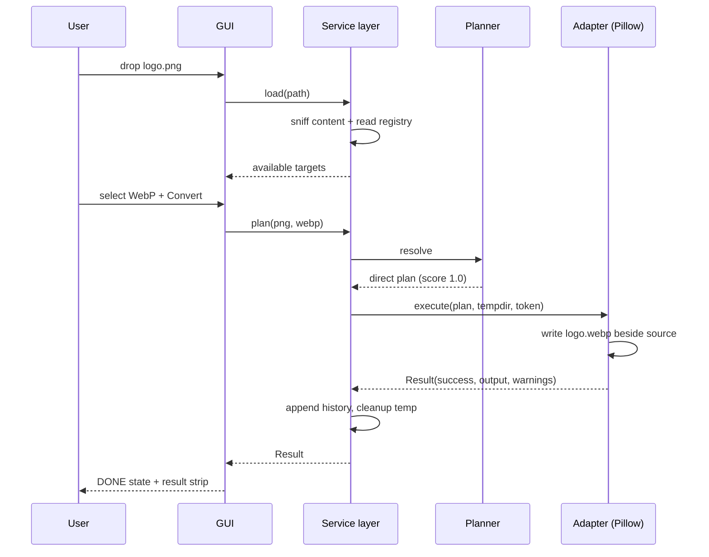
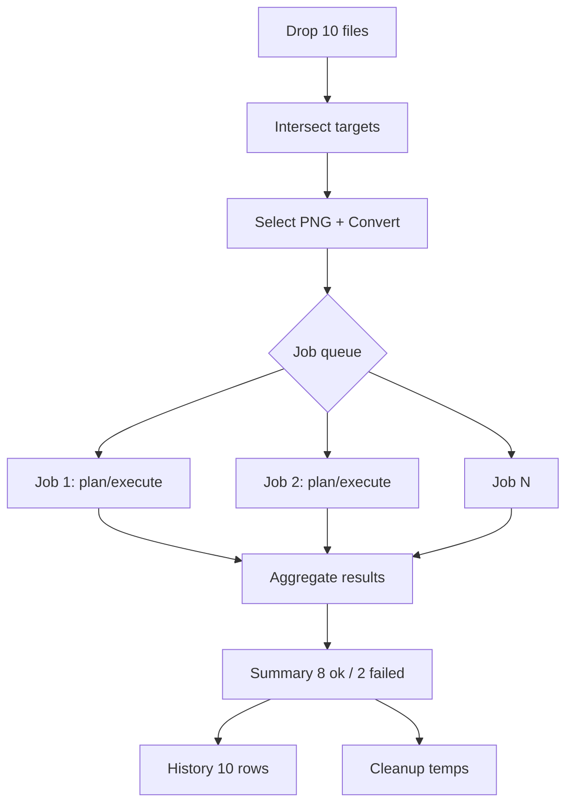
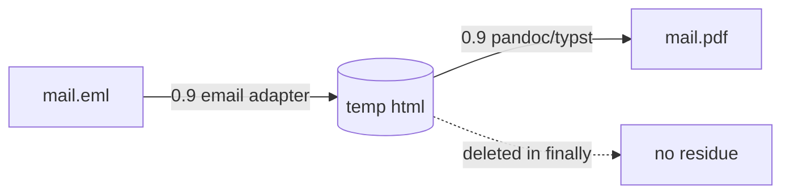

# User Flows — Any2Any

Flows cover GUI and CLI. Step order matters; fragments that could scramble order use numbered steps.

---

## Flow 1 — Single-file conversion (GUI)

1. User opens Any2Any (state EMPTY).
2. User drops `logo.png` (or clicks browse, picks file).
3. App sniffs content (PNG magic), confirms type, lists target formats: WebP, JPEG, TIFF, BMP, ICO, SVG (vectorize), PDF (P1), … (state LOADED).
4. User picks **WebP**. Advanced settings show `quality=85` (default).
5. App computes plan: direct edge `png→webp` fidelity 1.0. Plan badge: "Direct".
6. User clicks **Convert** (state RUNNING).
7. Engine writes `logo.webp` beside source; verifies non-zero output; removes temp; history row appended (state DONE).
8. Result strip: "logo.webp created · Open folder".

Failure branch at 7: error row with code (e.g., E_PARSE on corrupt input); history row records failure; source untouched.



## Flow 2 — Batch conversion

1. User drops 10 files (mixed PNG/JPEG).
2. Format combo shows intersection of supported targets (JPEG→PNG valid for all).
3. User selects PNG; Convert.
4. Job manager queues 10 jobs (parallelism 4 default).
5. Each job: plan → execute → result. Per-row status updates; overall `3/10`.
6. Two rows fail (corrupt files). Run finishes as DONE_WITH_ERRORS.
7. Summary: "8 created, 2 failed — Show details". History stores all 10.
8. CLI equivalent: `any2any convert *.img --to png --json` → summary object; exit code 2 if any file failed, 0 if all ok.



## Flow 3 — CLI single and batch

```bash
any2any convert report.pdf --to docx            # single
any2any convert *.csv --to json                 # batch glob
any2any convert data.csv --to json --set delimiter semicolon
any2any formats data.csv                        # targets with steps + score
any2any convert x.eml --to pdf --explain        # shows chain via HTML
any2any convert *.png --to jpg --force --quality 90 --out-dir ./web
any2any doctor                                  # engine report
any2any licenses                                # third-party notices
```

Exit codes: 0 all success; 1 usage error; 2 partial failure (some files failed); 3 total failure (all failed or fatal); 4 missing engine; 5 user cancelled (SIGINT); 6 conflict refused (no --force and skip policy). See `07-cli-specification.md`.

## Flow 4 — Chained conversion (plan transparency)

1. User selects `mail.eml` → target PDF.
2. Planner finds no direct edge; computes best path EML→HTML (0.9) → HTML→PDF (0.9) = 0.81; alternatives listed.
3. GUI shows plan chip: "EML → HTML → PDF · est. quality 81% · intermediates auto-deleted". First time: explainer modal (remembered dismissal).
4. Convert executes step 1 into job temp dir; step 2 reads intermediate; intermediate deleted in `finally` block even on failure.
5. Failure of step 2 with fallback routes enabled: planner tries next-best route (max 3); if all fail → E_PLAN_FAILED with per-route reasons.

CLI: default prints one line `plan: eml→html→pdf (0.81)`; `--explain` prints full tree; `--direct-only` forces E_UNSUPPORTED_PAIR.



## Flow 5 — Missing dependency recovery

1. User selects MP4→MP3; Convert.
2. Planner resolves plan but dependency check fails: ffmpeg not found.
3. GUI shows S5 installer: name, pinned version, size, license, checksum, source URL. Two actions: download (consent) or manual instructions.
4. On success: re-run plan automatically if user had pressed Convert; otherwise enable Convert.
5. Offline user: manual instructions only; no silent partial download.

CLI: `any2any convert a.mp4 --to mp3` → stderr diagnostic + exit 4; `any2any doctor` lists all engines.

## Flow 6 — Cancellation

1. During RUNNING, user presses Cancel / Ctrl-C.
2. Job manager flips token; running subprocesses receive terminate (grace 2s, then kill).
3. Partial outputs for the cancelled file removed; completed files in the batch kept (status per file).
4. Temp job dir removed; history row = cancelled.
5. GUI state DONE (with cancelled count); CLI exit 5.

## Flow 7 — Existing output conflict

- GUI default policy `ask`: dialog Overwrite / Keep both / Skip (Keep both preselected → `name (1).ext`).
- CLI default `skip` with warning; `--force` overwrites; `--on-conflict ask|skip|overwrite|fail` explicit.
- Never overwrite without policy — acceptance test EC-08.

## Flow 8 — Settings change

Settings dialog → save to per-user config file (see `08-data-storage-and-privacy.md`) → in-memory service reconfigured → new conversions use new defaults; running jobs unaffected.

## Flow 9 — History review

History table (newest first) → row double-click → detail modal (plan, options, errors) → "Re-run" clones job with same inputs/options. "Clear history" confirms twice.

## Flow 10 — Extension/content mismatch

1. `photo.png` actually contains JPEG data (sniff mismatch).
2. Warning row: "Extension says PNG, content is JPEG. Use detected type / Use extension / Cancel".
3. Decision recorded for the run; plan computed on chosen type.
