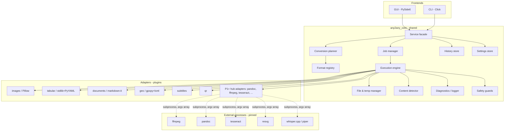
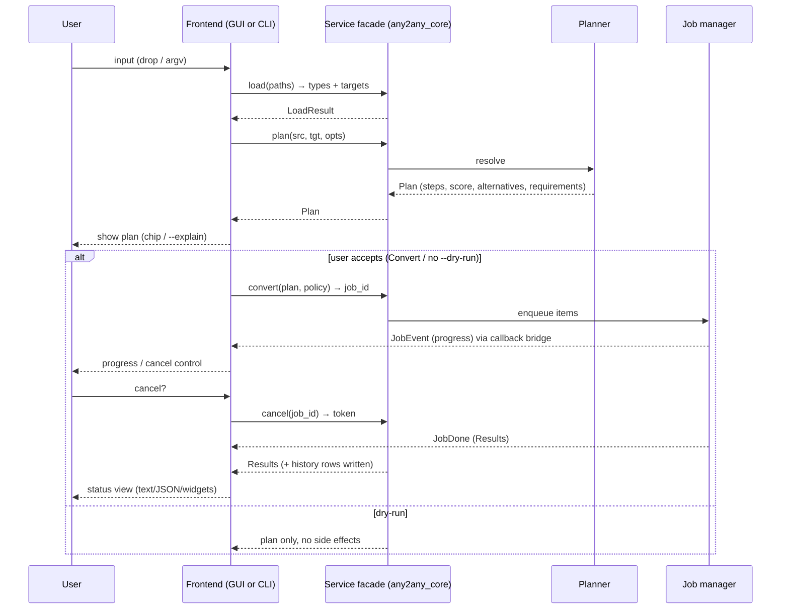
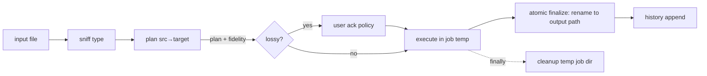

# System Architecture — Any2Any

**Status:** proposed, independent design. 2anything's private internals are unknown; observable mechanisms (registry of engines, scored multi-step routes, temp intermediates, process-isolated tools) informed the requirements, not the implementation.

---

## 1. Component overview

### Component responsibilities

| Component | Responsibility | Shared GUI/CLI |
|---|---|---|
| Service facade | Single API: `load`, `plan`, `convert`, `cancel`, `history`, `settings`, `formats`, `doctor`, `licenses` | yes |
| Format registry | Format metadata + adapter bindings + direction rules + options schema | yes |
| Conversion planner | Direct edge lookup; scored multi-step search; fallback routes; plan object | yes |
| Execution engine | Runs plan steps; lossiness warnings; result model | yes |
| Job manager | Queue, parallelism, progress events, cancellation tokens | yes |
| File & temp manager | Per-job temp dirs, naming, atomic finalize (write temp → rename into place), cleanup, stale sweep | yes |
| Content detector | Magic-byte sniffing vs extension; mismatch signal | yes |
| History store | Append-only local log (JSONL or SQLite), query, clear | yes |
| Settings store | User config (TOML/JSON in config dir), validation | yes |
| Diagnostics | Structured logs, redaction, `--debug`; no file contents | yes |
| Safety guards | Path traversal checks, zip limits, subprocess hardening, disk-space check | yes |
| GUI | Presentation + dialogs only; no conversion logic | — |
| CLI | Argument parsing + presentation (text/JSON); no conversion logic | — |

**Rule:** GUI and CLI contain zero conversion logic; both call the same facade. Any behavior difference is a facade option, not a fork.

### Frontend ↔ core interactions (shared contract)

The same facade method signatures serve both frontends; only presentation of `JobEvent` differs (Qt signals vs stdout lines/NDJSON).

## 2. Data flow (single conversion)

## 3. Architecture decision records (ADR)

### ADR-001: Core language — Python 3.12

- **Context:** One developer, broadest format coverage, permissive licensing, subprocess orchestration, testability.
- **Options:**
  1. Python + PySide6 + Click — richest data/science ecosystem (pyarrow, pyreadstat, Pillow, gpxpy), fastest delivery.
  2. Rust core + Tauri GUI + clap — best performance/packaging, small binary; data-format ecosystem weak; longer timeline.
  3. Go + Fyne/Wails — good concurrency; weakest format libraries.
  4. Electron + Node — UI velocity; weaker binary-format coverage; large footprint.
- **Decision:** Python 3.12 for MVP. Heavy lifting delegated to pinned external binaries or native libs anyway (Pillow C, pyarrow).
- **Consequences:** Packaging via PyInstaller/Briefcase must be solved (M5); startup NFR-8 monitored. Revisit Rust core only if profiling shows Python-bound hotspots (documented trigger).

### ADR-002: GUI framework — PySide6

- **Options:** PySide6 (LGPL), PyQt (GPL, problematic for proprietary forks), Tkinter (poor a11y/look), Tauri webview (second stack/language), native Swift/WinUI (per-OS cost).
- **Decision:** PySide6. Commercial-friendly LGPL with dynamic linking; mature drag-drop, accessibility bridges, one codebase for 3 OSes.
- **Consequences:** App bundle must load Qt dynamically to stay LGPL compliant; ship Qt license text.

### ADR-003: Process isolation of external tools

- **Context:** pandoc (GPL-2+), piper (GPL-3+), ffmpeg (LGPL w/ optional GPL components) must not impose license on our MIT core, and version conflicts must be containable. 2anything publicly adopted exactly this strategy (VERIFIED: release 0.22.1 "ffmpeg and pandoc ship as separate programs, pinned to exact versions with verified checksums").
- **Decision:** All heavy/CLI tools spawn as separate processes with argv arrays; never `ctypes`/link into core; versions pinned in lock manifest with SHA-256; license texts bundled; `any2any licenses` prints all.
- **Alternatives rejected:** in-process dynamic linking (license + crash isolation risk), container-per-job (overkill for desktop), shelling out via string (injection risk — forbidden by FR-8.1).

### ADR-004: Persistence — files, not services

- **Decision:** Settings = single TOML/JSON file in user config dir. History = SQLite (indexed, handles 100k rows) with JSONL fallback if sqlite unavailable. No DB server, no daemon.
- **Alternatives rejected:** JSON-only history (slow at scale), embedded daemon (complexity), cloud sync (violates privacy goals).

### ADR-005: Chain transparency

- **Context:** 2anything chains silently (VERIFIED by EML blog: "You don't have to know any of this in the app").
- **Decision:** Any2Any shows the plan before/while converting (GUI chip, CLI `--explain`), supports `--direct-only`, and reports per-step scores. Mission requires no silent chaining.
- **Trade-off:** slightly more UI noise; mitigated by one-time explainer and compact chips.

### ADR-006: Overwrite policy

- **Decision:** GUI default = ask (preselect keep-both); CLI default = skip + warning; `--force` overwrites. No silent overwrite anywhere (mission requirement; 2anything's default is documented as "appears next to the original, same name" — conflict behavior UNKNOWN → we choose explicit policy).

### ADR-007: Temp strategy

- **Decision:** One temp root per job (`$TMP/any2any/<job-id>/`), chmod user-only; steps write intermediates there; final output written as `.<name>.part` next to target then atomic rename; `finally:` cleanup; startup sweep of dirs older than 24h. Disk pre-check: need estimated output size (best-effort) before start.
- **Evidence for need:** 2anything documents temp intermediates + deletion even on failure (VERIFIED) and large temp needs for TTS (1.4 GB for 9h book) — we surface temp usage estimates for P3 TTS.

### ADR-008: Detection strategy

- **Decision:** Extension first (fast path for known extensions), magic bytes confirm; mismatch → user choice (GUI) / warning + `--trust content|extension` (CLI). Unknown extension + unknown magic → E_UNSUPPORTED_INPUT.

### ADR-009: Update mechanism

- **Decision:** None in MVP. Releases distributed via GitHub Releases; users check manually. (Removes the original's update-check network request class entirely; documented in `08-data-storage-and-privacy.md`.)

### ADR-010: Plugin model

- **Decision:** Adapters are Python entry points (`any2any.adapters` group) or built-in modules registered at import; external format packs installable as separate packages without core changes. Registry validates schema at load; broken adapter disables only itself.

## 4. Shared vs frontend-specific concerns

| Concern | Shared core | GUI | CLI |
|---|---|---|---|
| Planning, execution, safety | ✓ | — | — |
| Progress events (callback/queue) | ✓ emits | subscribes, renders bars | subscribes, prints lines / JSON events |
| Conflict resolution | defines policies | modal dialog | flags |
| Lossy acknowledgment | defines per-pair ack store | dialog | `--accept-lossy` / prompt TTY only |
| Output presentation | Result objects | widgets | text/JSON |

## 5. Threading/async model

- Core is synchronous with explicit job manager; GUI wraps jobs in `QThreadPool` workers; CLI runs a process-local executor.
- Progress via thread-safe callback interface (GUI: signal bridge; CLI: direct print).
- Subprocesses: communicate via pipes/files; poll cancellation token; terminate→kill escalation.
- No global interpreter locks issues for subprocess-bound work; Pillow work releases GIL partially; CPU-heavy pure-python steps run in worker processes only if profiling demands (future ADR).

## 6. Packaging & distribution (summary; details M5)

- Dev: `pip install -e .[gui,cli]`.
- Release: PyInstaller one-folder per OS (one-file rejected: startup cost); optional sidecar tools downloaded via S5 manager into app-managed engines dir with checksums.
- Reproducibility: lockfile (`requirements.lock` + tool manifest with SHAs), CI builds on pinned runners, published SBOM + `any2any licenses`.
- Signing: macOS notarization and Windows signing listed as M5 exit criteria (not free; risk noted).

## 7. Testing architecture

- Unit: planner (pure), registry validation, safety guards, per-adapter fixtures.
- Contract: every adapter runs the shared adapter test suite (directions, options, cancellation, cleanup).
- Integration: CLI golden tests; GUI smoke via pytest-qt.
- Offline/network: sandboxed test asserting zero sockets during conversion.
- Fuzz: malformed CSV/JSON/XML/YAML/GPX inputs (hypothesis/Atheris).
- Details: `10-test-plan.md`.
