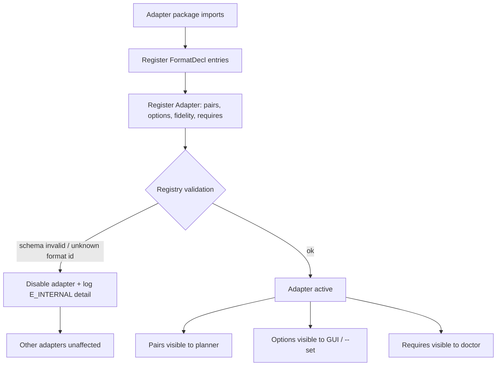
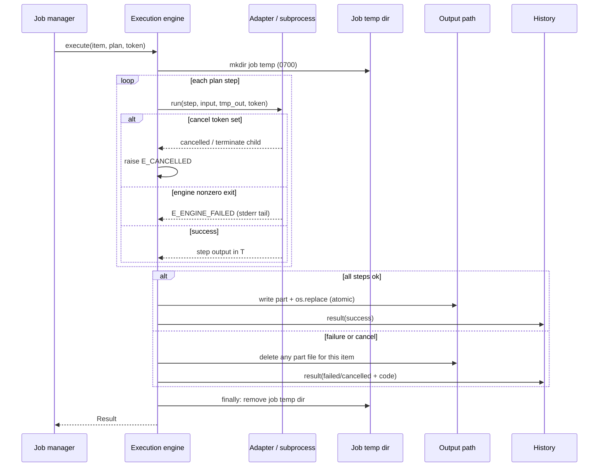

# Conversion Engine Specification — Any2Any

Registry-driven, plan-then-execute. Design informed by 2anything's publicly described mechanism (VERIFIED: >20 engines, 0–1 fidelity scores, product-of-scores best route, ≤3 fallbacks, temp intermediates) but specified independently.

## 0. Adapter registration flow



Registration is additive: core never edits when a format lands (roadmap M6 acceptance AC-6.2).

---

## 1. Format registry

### 1.1 Format declaration

```python
@dataclass(frozen=True)
class FormatDecl:
    id: str                # "png", "jpeg", "json"
    category: str          # image, data, document, geo, subtitle, audio, video, font, archive, cert, util
    extensions: tuple[str, ...]     # ".png", ".jpg" (normalized lowercase, leading dot)
    mime: str | None
    lossy: bool            # format intrinsically lossy (jpeg) vs lossless (png)
    loss_notes: str | None # human text shown on selection
    encoding: str = "binary"        # "binary" | "text" | "structured"
```

### 1.2 Adapter declaration

```python
class Adapter(Protocol):
    id: str                              # "pillow_images"
    sources: tuple[str, ...]             # format ids readable
    targets: tuple[str, ...]             # format ids writable
    pairs: dict[tuple[str, str], PairSpec]   # explicit per-pair override; default = sources × targets
    requires: tuple[Requirement, ...]    # external engine ids or python packages
    options: tuple[OptionSpec, ...]      # schema for --set / advanced settings
    fidelity: dict[tuple[str, str], float]  # per-pair score 0..1 default
    error_map: dict[ExceptionType, str]  # → error taxonomy code

@dataclass(frozen=True)
class PairSpec:
    source: str
    target: str
    direct: bool = True           # False → registered edge excluded from direct plans
    constraints_in: str | None    # e.g. "single frame only"
    constraints_out: str | None
    input_lossiness_notes: str | None   # what source fidelity survives
    test_fixture: str             # path to fixture used in contract tests
```

**Direction rule:** `targets` never implies `sources`. A pair is supported only if explicitly in `pairs` (or default cross product for simple adapters). FIT→DOCX therefore fails at registry level: no adapter declares FIT as source and DOCX as target.

### 1.3 Requirements

```python
@dataclass(frozen=True)
class Requirement:
    kind: str          # "binary" | "python" | "model" | "datafile"
    name: str          # "ffmpeg" / "pyarrow" / "whisper-base-en"
    version_pin: str | None
    sha256: str | None       # for binaries/models we distribute
    license: str | None
    download_url: str | None # only used by explicit consent installer
    required_for: tuple[tuple[str, str], ...]  # pairs needing it (for error messages)
```

`any2any doctor` evaluates Requirements; planner pre-checks them per plan.

## 2. Conversion planner

### 2.1 Algorithm

1. **Normalize** input type: sniffed type (user-confirmed) → source format id.
2. **Direct lookup:** if edge (src,tgt) exists and passes direction rules → plan `[step]`, fidelity = edge score.
3. **Multi-step search:** build graph of format nodes, edges = registered pairs with scores. Find paths src→tgt maximizing **product of scores** (equivalently minimize sum of `-log(score)`), subject to:
   - max hops = 3 (constant `MAX_HOPS`, documented; 2anything also uses multi-step with scoring — VERIFIED concept; hop cap is our spec),
   - intermediate formats must be registered as `writable` by some adapter and `readable` by the next,
   - cycle-free.
4. **Dijkstra on -log(score)** gives the best product path. Return top-K plans (K=3) sorted by score product then hop count as fallback routes.
5. **Direct-only mode:** skip step 3; missing direct edge → `E_UNSUPPORTED_PAIR` with nearest suggestions (same category first, then formats sharing an adapter).
6. **Dependency gate:** all `requires` resolved; else plan marked `blocked` with `E_MISSING_ENGINE` (still returned for display).

Scores are per-pair constants in adapters (starting values from fidelity table below), tunable without core changes.

### 2.2 Fidelity score scale (starting values)

| Edge class | Score | Rationale |
|---|---|---|
| Lossless re-encode same family (png→png via metadata strip) | 1.00 | data preserved |
| Lossless cross-format with full structure (csv→tsv, json→yaml, srt→vtt) | 0.95 | syntax change only |
| Intra-category lossless-ish (png→bmp, geo gpx→kml core attrs) | 0.90 | minor attribute loss |
| Lossy same family (png→jpeg q85, wav→mp3) | 0.85 | expected loss documented |
| Lossy with semantic mapping (csv→json, json→csv nested cells) | 0.80 | shape changes documented |
| Rendered formats (html→pdf via engine) | 0.90 | layout engine fidelity |
| Extractive/harder (pdf→docx tagged, email→html) | 0.75 | heuristic extraction |
| Vectorization (png→svg) | 0.60 | approximation |
| OCR / speech text extraction | 0.55 | recognition errors possible |
| Model transcription (audio→srt) | 0.50 | ASR error rate |

Scores are advertised as **relative estimates**, never accuracy guarantees (docs copy rule: no "95% accurate" claims).

### 2.3 Plan object

```python
@dataclass
class Plan:
    source_format: str
    target_format: str
    steps: list[Step]            # adapter_id, pair, options, temp role
    score: float                 # product of step scores
    lossy: bool                  # any step/format lossy
    requirements: list[Requirement]
    alternatives: list[Plan]     # fallback routes (≤ 2 extra)
    warnings: list[Warning_]     # lossy, chain, constraints
```

GUI/CLI always receive the Plan before execution (execution service requires a Plan; no hidden re-planning).

### 2.4 Examples

**Example 1 — direct:** `png→webp`: steps=[pillow pair], score 0.85, lossy, no alternatives.

**Example 2 — chain (mirrors documented EML→PDF class):** `eml→pdf`: no direct edge. Graph: eml→html (0.90) → pdf (0.90) = 0.81. Alternative: eml→txt (0.6) → pdf (0.9) = 0.54 — ranked second, not chosen. Plan presented: `eml → html → pdf (est. 0.81)`.

**Example 3 — unsupported:** `fit→docx`: FIT declared source for geo adapters only (targets gpx,kml,geojson,csv); DOCX target only reachable from document hub. Path search: fit→csv (0.90) → ??? csv→docx exists only as *table export* pair (declared output-only, direct=True for data hub). If data-hub csv→docx table export is registered (P1), plan = fit→csv→docx score 0.72 shown as chain; if not registered (P0), error `E_UNSUPPORTED_PAIR` listing `fit: gpx, kml, geojson, csv`.

**Example 4 — direction violation:** `docx→html` supported; `html→docx` supported via different adapter; `gif→avif` supported; `avif→gif` may be unsupported in early build — registry enforces exact pair membership.

## 3. Adapter contract (execution side)

```python
def execute(ctx: StepContext) -> StepResult:
    """Read ctx.input_path, write ONLY to ctx.output_path (temp),
    obey ctx.options (validated), check ctx.token between units,
    never modify inputs, never make network calls, never invoke shell strings."""
```

`StepContext` provides: validated options, temp dir, logger (path-level only), token, progress callback, engine resolver.

Contract tests every adapter must pass (run in CI):
1. Pairs declared are all convertible with fixtures; undeclared pairs raise `E_UNSUPPORTED_PAIR`.
2. Input file checksum unchanged after run.
3. Output exists, non-empty, parseable by a verifier for that format.
4. Cancellation mid-run → `StepCancelled`, no output residue (temp cleaned).
5. Missing engine → `E_MISSING_ENGINE` (not ImportError/stack trace).
6. Malformed fixture → mapped taxonomy error, process alive.
7. Options out of range rejected at validation layer before execute.
8. No sockets opened during execute (enforced test with socket monkeypatch/failure).

## 4. Job model

```python
@dataclass
class Job:
    job_id: str
    created_at: datetime
    mode: str                 # "single" | "batch"
    conflict_policy: str      # ask|skip|overwrite|fail|keep-both
    out_dir: Path | None      # None = beside source
    direct_only: bool
    accept_lossy: bool
    items: list[ItemJob]

@dataclass
class ItemJob:
    item_id: str
    source: Path
    plan: Plan | None
    options: dict
    status: Literal["pending","running","success","failed","skipped","cancelled"]
    result: Result | None
    started_at / finished_at
```

Progress events: `JobEvent(job_id, item_id, kind: plan|step_start|step_progress|item_done|job_done|error, payload)`.

## 5. Result model (unified GUI/CLI)

```python
@dataclass
class Result:
    item_id: str
    status: str
    source: Path
    output: Path | None
    plan_used: Plan | None
    warnings: list[Warning_]      # code + message + data
    error: Error_ | None          # taxonomy code, title, detail, hint, cause (exc type only)
    duration_ms: int
    bytes_in: int
    bytes_out: int | None
```

- GUI renders widgets; CLI renders text or `--json` (list of Result dicts, schema-versioned: `{"schema": "any2any.result/1", ...}`).
- History stores the same Result (minus bulky plan details beyond step summary).

## 6. Error taxonomy

| Code | Category | Meaning | User hint pattern |
|---|---|---|---|
| `E_USAGE` | input | bad invocation/options | show usage |
| `E_UNSUPPORTED_INPUT` | input | undetectable/unsupported source type | list supported inputs |
| `E_UNSUPPORTED_PAIR` | input | no path src→tgt | list alternative targets |
| `E_UNSUPPORTED_DIRECTION` | input | format exists but direction not writable | explain read-only |
| `E_EMPTY_FILE` | input | 0 bytes | — |
| `E_EXTENSION_MISMATCH` | input | extension ≠ content | choose trust mode |
| `E_PARSE` | data | malformed structured input | line/position if known |
| `E_CONFLICT_OUTPUT` | policy | target exists under policy=fail/ask-closed | suggest --force/keep-both |
| `E_PERMISSION` | io | read/write denied | pick another dir |
| `E_DISK_FULL` | io | ENOSPC or precheck fail | free space |
| `E_MISSING_ENGINE` | dep | requirement absent | doctor/install |
| `E_ENGINE_FAILED` | runtime | subprocess nonzero exit | tail of stderr, engine log |
| `E_TIMEOUT` | runtime | step exceeded limit | raise limit option |
| `E_CANCELLED` | control | user cancelled | — |
| `E_PLAN_FAILED` | runtime | all ≤3 routes failed | per-route reasons |
| `E_INTERNAL` | bug | unexpected exception | report path to log (redacted) |

Warnings: `W_LOSSY`, `W_CHAINED`, `W_EXTENSION_MISMATCH_ACCEPTED`, `W_PARTIAL_METADATA`, `W_LARGE_FILE_MEMORY` (documented in-memory limit for tabular), `W_DEGRADED_OUTPUT` (engine fell back).

## 7. Cleanup and partial output rules

1. All intermediate paths live under job temp dir; never beside user files.
2. Final output: write `part` file then `os.replace` to final name → readers never see partial files.
3. On failure/cancel: delete part files for that item; keep completed siblings in batch.
4. `finally` removes job temp dir; startup sweep removes orphaned `any2any-*` temps older than 24h.
5. History row written even for failures (with error code, no contents).
6. If disk full during part write: delete part, `E_DISK_FULL`, cleanup continues.

### 7.1 Error handling and cleanup sequence



Batch rule: sibling items already completed keep their outputs; only the failing/cancelled item's partials are removed.

## 8. Concurrency limits

- Batch default: `min(4, os.cpu_count())` workers for pure adapters.
- Engine-bound adapters declare `max_concurrency` (ffmpeg: 2; OCR: 1–2; TTS: 4 per VERIFIED 2anything blog precedent).
- Job manager respects per-adapter caps via weighted semaphore.

## 9. Extensibility demo (how a new format lands)

Adding Parquet in P1:
1. Register `parquet` FormatDecl (data category).
2. New adapter `pyarrow_adapter` with pairs (csv,parquet),(json,parquet),(parquet,csv),(parquet,json), option `compression=uncompressed|snappy|gzip|zstd`, fidelity 0.95 lossless, requires python `pyarrow`.
3. Contract tests + fixtures (tiny parquet generated in CI).
4. No core changes; format appears in GUI lists and `any2any formats` automatically.
